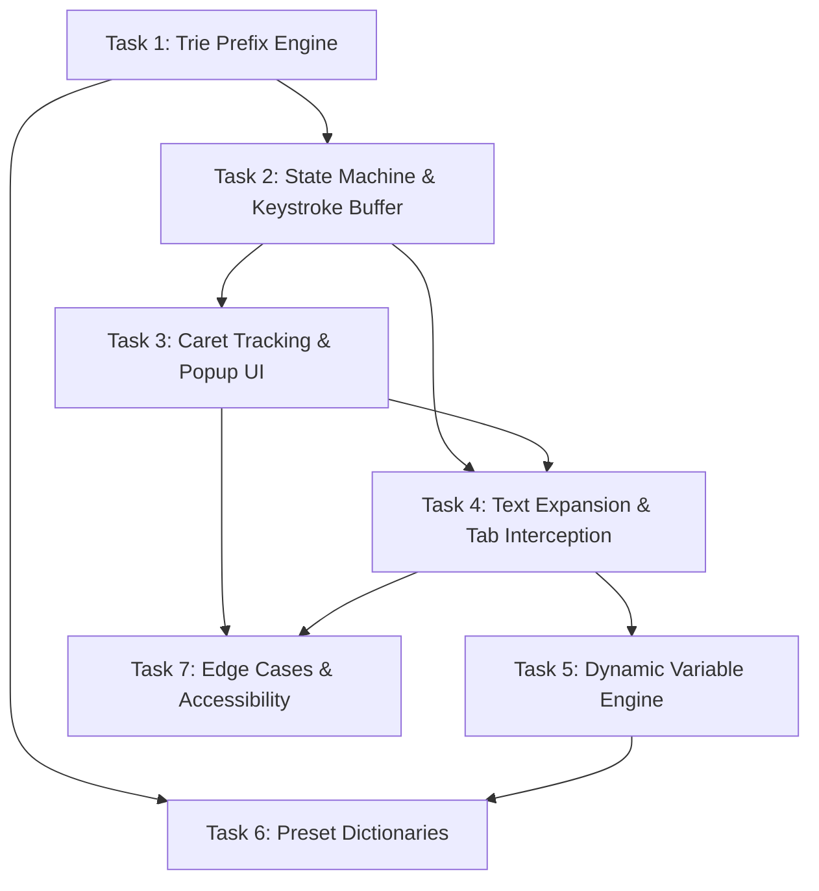

Here is a structured, production-ready breakdown of development tasks translated directly from your product specification and architecture requirements.

---

# Abbreviation Expander Application — Feature Task Breakdown

## 1. Context & Overview

### Feature Summary
The **Abbreviation Expander Application** is a real-time typing productivity engine designed for **Copywriters** and **QA Engineers**. As the user types, the application buffers printable keystrokes, performs sub-millisecond prefix lookups against a dictionary using a **Trie** data structure, displays an accessible floating candidate popup positioned at the text cursor, and replaces the typed abbreviation with dynamic/structured expansion templates upon pressing `Tab`.

### Key Assumptions & Dependencies
* **Target Environment**: Web application / content script / browser extension (DOM standard `HTMLInputElement`, `HTMLTextAreaElement`, and `contenteditable`).
* **Performance Budget**: Trie prefix lookup and UI popup rendering must execute within **$< 16\text{ms}$** (1 frame at 60fps) to ensure zero-latency typing feel.
* **APIs & Security**: Dynamic variable evaluation uses `navigator.clipboard.readText()` (requires proper permissions/fallbacks) and standard Selection/Range DOM APIs for caret coordinate calculations.

---

## 2. Task Breakdown

### Task 1: Prefix Lookup Engine ($O(k)$ Trie Data Structure)
* **Title:** Implement $O(k)$ Trie Data Structure for Abbreviation Prefix Lookup
* **Description:** Build an in-memory Trie (Prefix Tree) class in TypeScript to insert, look up, and dynamically retrieve candidate expansions based on buffered key prefixes. Search operations must complete in $O(k)$ time (where $k$ is prefix length) regardless of dictionary size.
* **Acceptance Criteria:**
  1. `Trie.insert(abbreviation: string, payload: ExpansionPayload)` correctly populates nodes.
  2. `Trie.searchPrefix(prefix: string): CandidateMatch[]` returns all candidate expansions matching the prefix in $O(k)$ time.
  3. Returns an empty result in $< 1\text{ms}$ when no matching prefix exists.
  4. Unit test suite achieves 100% test coverage across insert, update, exact prefix match, partial match, and clear operations.
* **Dependencies:** None
* **Priority:** High

---

### Task 2: Keystroke Buffer & Core State Machine Engine
* **Title:** Implement Keystroke Buffer and Core Engine State Machine
* **Description:** Implement the central state machine managing transitions across `IDLE`, `BUFFERING`, `POPUP_ACTIVE`, and `EXPANDED`/`CANCELLED` states. Listen to `keydown`/`input` events, buffer printable characters, and execute cancellation logic on whitespace, `Escape`, backspace, or modifier shortcuts.
* **Acceptance Criteria:**
  1. State transitions from `IDLE` to `BUFFERING` upon typing the first printable character.
  2. Transitions to `POPUP_ACTIVE` when `Trie.searchPrefix()` yields $\ge 1$ candidate match.
  3. Typing `Space`, `Enter`, non-printable shortcuts (`Ctrl+C`, `Cmd+V`), or `Escape` immediately resets state to `IDLE` and clears the keystroke buffer.
  4. Backspacing removes the last character in the buffer; if buffer length reaches 0, state resets to `IDLE`.
  5. Typing additional characters dynamically filters candidate matches; if matches drop to 0, popup closes and state resets to `IDLE`.
* **Dependencies:** Task 1
* **Priority:** High

---

### Task 3: Text Caret Coordinate Tracker & Floating Popup UI
* **Title:** Implement Caret Position Calculator and Accessible Floating Popup Component
* **Description:** Build a positioning utility that computes viewport $(x, y)$ coordinates for the text cursor inside `<input>`, `<textarea>`, and `contenteditable` elements. Render a floating candidate popup UI anchored to the caret with keyboard selection (`ArrowUp`/`ArrowDown`).
* **Acceptance Criteria:**
  1. Caret coordinate tracking correctly calculates floating popup placement in single-line inputs, multi-line textareas, and scrolled containers.
  2. Popup component includes screen-boundary detection (automatically flips above cursor if caret is near viewport bottom).
  3. Highlights top match by default; active item updates seamlessly via `ArrowUp` and `ArrowDown` navigation.
  4. Renders without triggering DOM reflow loops or visual jitter during rapid typing.
* **Dependencies:** Task 2
* **Priority:** High

---

### Task 4: Text Expansion & DOM Replacement Engine
* **Title:** Implement Text Replacement & Tab Key Interception
* **Description:** Implement key interception for `Tab` when in `POPUP_ACTIVE` state. Prevent default tab behavior (focus shift), calculate string deletion/insertion offsets in the active DOM text control, replace the typed abbreviation prefix with the selected expansion text, and restore focus.
* **Acceptance Criteria:**
  1. Intercepts `Tab` key when popup is active and executes `event.preventDefault()` to guard focus shift.
  2. Calculates range `[caretPosition - bufferLength, caretPosition]` and replaces typed prefix with expansion content.
  3. Repositions text control cursor immediately after the newly inserted expanded text.
  4. Functions seamlessly in `<input>/<textarea>` (via `setRangeText`) and `contenteditable` (via `Selection`/`Range` API).
  5. Dismisses popup and resets state machine to `IDLE` post-expansion.
* **Dependencies:** Task 2, Task 3
* **Priority:** High

---

### Task 5: Dynamic Variable & Template Interpolation Engine
* **Title:** Build Dynamic Variable Parsing Engine (`{{date}}`, `{{clipboard}}`, `{{cursor}}`)
* **Description:** Implement a template engine that parses dynamic tokens within expansion payloads at insertion time. Support `{{date}}`, `{{time}}`, `{{clipboard}}`, and `{{cursor}}` placement markers.
* **Acceptance Criteria:**
  1. `{{date}}` evaluates to current local date formatted according to configurable formatters (e.g., `YYYY-MM-DD`).
  2. `{{clipboard}}` evaluates asynchronously to current system clipboard content via Clipboard API, gracefully falling back to empty string if permission is denied.
  3. If `{{cursor}}` marker is present in template, text cursor is placed precisely at the `{{cursor}}` position post-replacement instead of the end of the text.
  4. Unit tests verify parsing of multiple nested variables in a single expansion payload.
* **Dependencies:** Task 4
* **Priority:** Medium

---

### Task 6: Preset Dictionaries for Copywriters & QA Engineers
* **Title:** Build Preset Abbreviation Packs & Validation Schema
* **Description:** Define a validated JSON schema for abbreviation packs and author comprehensive built-in presets tailored for Copywriters (disclaimers, tone guidelines, email sign-offs) and QA Engineers (Markdown bug templates, steps to reproduce, environment matrices).
* **Acceptance Criteria:**
  1. JSON schema enforces fields: `id`, `prefix`, `title`, `expansion`, `category`, and `tags`.
  2. Copywriter pack includes multi-line legal disclaimers, brand voice rules, and `{{date}}` tokens.
  3. QA Engineer pack includes Markdown bug report templates (Steps to Reproduce, Expected vs Actual Results, Environment specs matrix).
  4. Schema validator module prevents loading malformed dictionary files.
* **Dependencies:** Task 1, Task 5
* **Priority:** Medium

---

### Task 7: Edge Case Handling, Blur Detection, & Accessibility
* **Title:** Implement Edge Case Resilience, Blur Detection, and ARIA Accessibility
* **Description:** Harden the application against focus shifts, window resizing, pasting text mid-abbreviation, caret repositioning via mouse clicks, and missing accessibility attributes.
* **Acceptance Criteria:**
  1. Window `blur`, element `blur`, or mouse `click` outside the active text container instantly dismisses popup and resets state to `IDLE`.
  2. Pasting text into text control resets keystroke buffer to prevent corrupt prefix state.
  3. Caret repositioning via mouse click or arrow keys clears buffer and resets state.
  4. Popup UI includes proper ARIA roles (`role="listbox"`, `role="option"`, `aria-activedescendant`) for screen reader compliance.
  5. Keystroke lookup & render latency remains strictly under $16\text{ms}$ under rapid typing benchmarks (100+ wpm).
* **Dependencies:** Task 3, Task 4
* **Priority:** Medium

---

## 3. Technical Considerations & Edge Cases

* **$O(k)$ Lookup Guarantee**: Avoid using simple array scanning (`Array.prototype.filter`) over dictionary lists on every keystroke. Using a **Trie** guarantees lookup time is bounded only by prefix length $k$.
* **Caret Measurement Strategy**: Measuring text cursor coordinates in standard textareas requires mirrored hidden DOM elements with cloned font/padding styles to calculate accurate bounding box offsets.
* **Keyboard Event Guarding**: `Tab` interception must **only** trigger `event.preventDefault()` when `POPUP_ACTIVE` state is true and candidate list is non-empty. In all other scenarios, standard tab navigation must remain unaffected.
* **Async Clipboard Graceful Handling**: Clipboard reads must never block UI thread execution or throw unhandled promise rejections.

---

## 4. Sequencing & Dependency Graph

### Critical Path Execution
1. **Sprint Phase 1 (Foundation)**: Task 1 $\rightarrow$ Task 2
2. **Sprint Phase 2 (Core UI & Action)**: Task 3 & Task 4 (Can be developed in parallel once Task 2 completes)
3. **Sprint Phase 3 (Features & Content)**: Task 5 $\rightarrow$ Task 6
4. **Sprint Phase 4 (Hardening)**: Task 7

---

## 5. Gaps & Open Questions

1. **Rich Text / WYSIWYG Support Scope**:
   * *Question*: Does MVP require rich text / HTML fragment expansion for WYSIWYG editors (e.g., ProseMirror, Draft.js, TinyMCE), or plain text / markdown replacement in standard text controls?
2. **Deployment Context**:
   * *Question*: Will this engine be published as a standalone JS library, embedded as a Chrome Extension Manifest V3 content script, or wrapped as a native OS IME app?
3. **User Customization Storage**:
   * *Question*: Should custom user abbreviations be editable in a UI and saved to `localStorage` / Chrome sync storage in MVP, or managed exclusively via static JSON files?